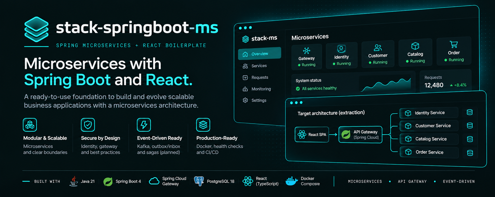

A microservices-oriented evolution of the Spring + React boilerplate. It uses Java 21, Spring Boot 4.1.2, Spring Cloud Gateway MVC, PostgreSQL 18, and Docker Compose.

> **Extraction status:** the existing application behavior is still implemented in the Spring monolith under `backend/`, served with the React frontend by the development/proxy stack. The standalone service modules and per-service databases are scaffolded; business behavior and security controls have not yet been fully extracted. See [the extraction plan](doc/microservices-architecture.md).

## Services

| Service | Responsibility | Port (internal) |
| --- | --- | ---: |
| `gateway-service` | API routing | 8080 |
| `identity-service` | Authentication and identity | 8101 |
| `customer-service` | Customer profiles and addresses | 8102 |
| `catalog-service` | Products and inventory | 8103 |
| `order-service` | Orders and fulfillment | 8104 |

Each business service has its own PostgreSQL database and Flyway configuration. The Gateway routes `/api/auth/**`, `/api/customers/**`, `/api/products/**`, and `/api/orders/**`.

## Run locally (implemented application)

```sh
cp .env.example .env
docker compose -f compose.dev.yml up --build
```

The monolith-backed application is available at `http://localhost`. This is the recommended starting point for a new application. Build the extracted service shells separately with:

```sh
cd backend && ./gradlew buildServices
```

To exercise the optional microservice routing scaffold, run `docker compose -f compose.microservices.yml up --build`; the Gateway is available at `http://localhost:8080`. Treat it as an extraction scaffold, not a production-ready replacement.

The supported development/runtime path for existing business behavior is the monolith under `backend/`; the extracted service stack is for exercising the service shells and routing only. Its readiness checks confirm process/database readiness, not feature parity or production security. Releases are gated on the backend, service, frontend, and high/critical vulnerability checks.

## Current and target architecture

The current business application still runs as a monolith behind Nginx:

```text
React SPA → Nginx → Spring monolith (`backend/`) → PostgreSQL
```

The following is the **target extraction**, not yet the production-equivalent application:

```text
React SPA → Gateway → Identity / Customers / Catalog / Orders
                         │           │          │       │
                       own DB      own DB     own DB  own DB
```

Services communicate through explicit HTTP APIs for synchronous request/response and versioned domain events for asynchronous work. Kafka and transactional outbox/inbox delivery are the planned event backbone; the order fulfillment workflow is modeled as a saga. Never share database tables or persistence entities across services.

Read [the microservices architecture and extraction plan](doc/microservices-architecture.md) before adding a new service or moving a bounded context.

Architecture and security rules are normative for new work. Review the [security baseline](doc/security-baseline.md) and [technical architecture reference](doc/architecture-reference.md) before changing trust boundaries, service contracts, data ownership, or authentication.

To start a new application from a fresh copy, run `make init` to set its display name and Java package. Read [Using this repository as a template](doc/using-as-template.md) first; the command modifies files in place and is intended for a new copy, not an existing application.

All Java build files, the Gradle wrapper, shared service architecture tests, optional microservice scaffolds, and the template initializer live under `backend/`. `frontend/` is the separate React app. `renovate.json` remains at the repository root as repository-wide dependency automation configuration; local Gradle/pnpm caches are generated artifacts and are ignored by Git.
